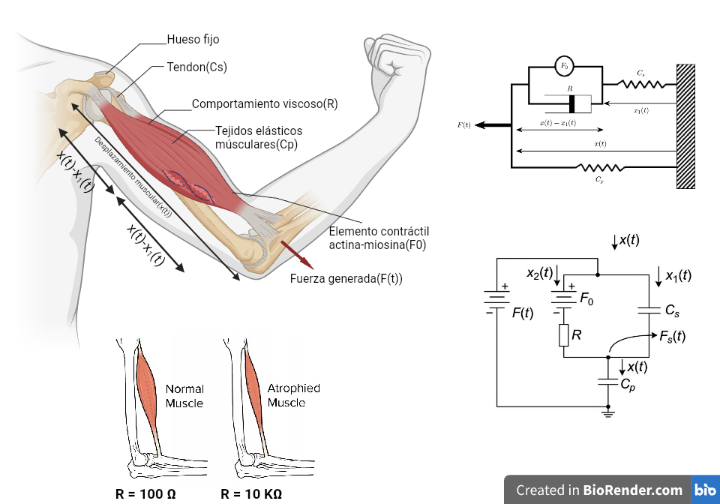
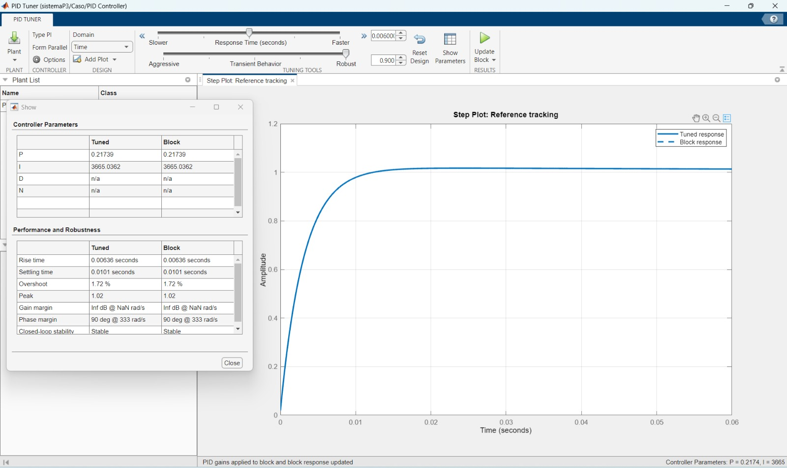
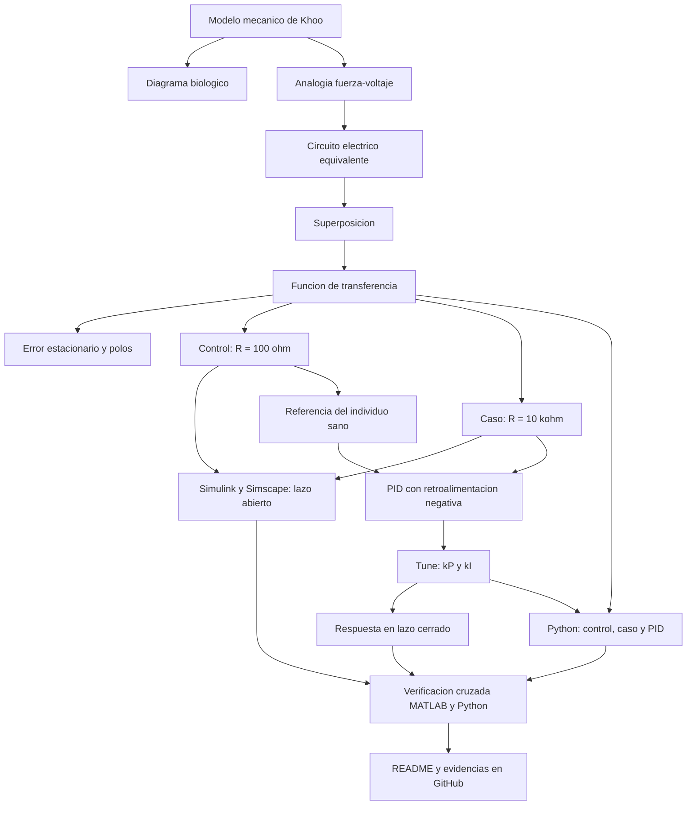

# Práctica 3 — Modelado y control del sistema musculoesquelético

Repositorio académico de la asignatura **Modelado de Sistemas Fisiológicos**, correspondiente al programa de **Ingeniería Biomédica** del Tecnológico Nacional de México / Instituto Tecnológico de Tijuana. Esta práctica integra modelado mecánico, analogía electromecánica fuerza–voltaje, análisis de error y estabilidad, diseño de un controlador PID, simulación computacional y verificación cruzada entre herramientas.

El caso de estudio representa un compartimento musculoesquelético mediante el modelo viscoelástico de Khoo. Se compara la respuesta de un **individuo sano (control)** con la de un **caso simulado de atrofia muscular (caso)**, y se diseña un controlador que reduce la diferencia entre ambas respuestas.

**Docente:** Dr. Paul Antonio Valle Trujillo  
**Correo:** paul.valle@tectijuana.edu.mx  
**Departamento:** Ingeniería Eléctrica y Electrónica  
**Institución:** Tecnológico Nacional de México / Instituto Tecnológico de Tijuana  
**Asignatura:** Modelado de Sistemas Fisiológicos  
**Programa:** Ingeniería Biomédica  
**Estudiante:** Gustavo Ortega Odabachea · 23212223 · L23212223@tectijuana.edu.mx

**Repositorio de la asignatura:** https://github.com/DrPaulValle/MSF-IBF1020  
**Sede:** Blvd. Alberto Limón Padilla s/n, Tijuana, C. P. 22454, B. C., México.

---

<a id="contenido"></a>
## Contenido

1. [Resumen](#resumen)
2. [Competencia y objetivos](#objetivos)
3. [Relación con el temario](#temario)
4. [Modelo físico y analogía eléctrica](#analogia)
5. [Formulación matemática](#modelo)
6. [Análisis temporal y de estabilidad](#analisis)
7. [Señales de entrada y condiciones de simulación](#senales)
8. [Implementación en MATLAB, Simulink y Simscape](#matlab)
9. [Control en lazo cerrado y sintonización PID](#pid)
10. [Reproducción en Python](#python)
11. [Resultados y verificación cruzada](#resultados)
12. [Flujo de trabajo](#flujo)
13. [Actividades del estudiante](#actividades)
14. [Estructura del repositorio](#estructura)
15. [Requisitos](#requisitos)
16. [Reproducibilidad y entregables](#reproducibilidad)
17. [Referencias](#referencias)

---

<a id="resumen"></a>
## Resumen

La práctica tiene como propósito **reproducir un procedimiento completo de modelado, análisis, simulación y control** de un sistema fisiológico. El compartimento musculoesquelético se representa con un elemento contráctil $F_0(t)=\alpha F(t)$, un amortiguador viscoso $R$, un elemento elástico en serie $C_s$ (tendón) y uno en paralelo $C_p$ (tejidos musculares). Mediante la analogía fuerza–voltaje se obtiene un circuito eléctrico equivalente y, aplicando el principio de superposición, la función de transferencia entre la fuerza aplicada y la salida del sistema.

El **control** ($R=100\,\Omega$) y el **caso** de atrofia ($R=10\,\mathrm{k}\Omega$) comparten $\alpha$, $C_s$ y $C_p$; sólo cambia $R$, lo que vuelve la respuesta del caso unas 100 veces más lenta. Se estudian el error en estado estacionario y la estabilidad a través de los polos, y se incorpora un **controlador PI con retroalimentación negativa** que toma la respuesta del individuo sano como referencia. Los resultados se reproducen en Simulink, Simscape Electrical, MATLAB y Python.

**Palabras clave:** sistema musculoesquelético; modelo de Khoo; atrofia muscular; analogía fuerza–voltaje; controlador PID; MATLAB; Simulink; Simscape Electrical; Python; simulación *in silico*.

[Volver al contenido](#contenido)

---

<a id="objetivos"></a>
## Competencia y objetivos

### Competencia a desarrollar

Modelizar sistemas fisiológicos mediante analogías entre sistemas físicos, ecuaciones diferenciales y funciones de transferencia para analizar su comportamiento dinámico, y diseñar estrategias de control mediante técnicas de control clásico.

### Objetivos específicos

- Identificar los elementos $F_0(t)$, $F(t)$, $R$, $C_p$, $C_s$, $x(t)$ y $x_1(t)$ del modelo mecánico y sus restricciones.
- Construir el circuito eléctrico equivalente mediante la analogía fuerza–voltaje.
- Obtener la función de transferencia por superposición para control y caso.
- Determinar el error en estado estacionario y analizar la estabilidad mediante los polos.
- Simular el modelo con ecuaciones, función de transferencia y componentes de Simscape Electrical.
- Comparar control, caso y sistema controlado en lazo abierto y cerrado.
- Implementar y sintonizar un controlador PID.
- Reproducir los resultados en MATLAB y Python, elaborar el diagrama biológico y documentar en GitHub.

[Volver al contenido](#contenido)

---

<a id="temario"></a>
## Relación con el temario

La práctica integra contenidos de tres unidades del programa de **Modelado de Sistemas Fisiológicos (IBF-1020)** y desarrolla la competencia específica de la asignatura: emplear el control clásico y las técnicas de modelizado de sistemas para aplicarlas en procesos fisiológicos.

| Unidad | Subtemas del temario | Aplicación en la práctica |
|---|---|---|
| 1. Sistemas de control retroalimentados | 1.1 Elementos de sistemas de control | Planta, referencia, controlador y señal de error del esquema de lazo cerrado |
| | 1.2 Función de transferencia | Funciones de control y caso; polos y ceros |
| | 1.3 Diagramas de bloques | Modelo en Simulink y diagrama de control (control como referencia del caso) |
| | 1.4 Respuesta ante impulso, escalón y rampa | Respuesta de control, caso y sistema controlado ante una entrada tipo impulso (pulso de $1\,\mathrm{s}$) |
| | 1.5 Análisis de error | Error en estado estacionario ante escalón |
| | 1.6 Estabilidad relativa y absoluta | Polos de control y caso; márgenes de ganancia y fase del lazo cerrado |
| | 1.7 Criterios de estabilidad | Estabilidad por ubicación de polos en el semiplano izquierdo |
| 2. Modelado matemático | 2.6 Sistema musculoesquelético | Modelo de Khoo, analogía fuerza–voltaje y circuito equivalente |
| 3. Controladores | 3.1 Tipos de controladores | Controlador PI (PID con $k_D=0$) |
| | 3.2 Diseño de controladores | Retroalimentación negativa y realización con componentes analógicos |
| | 3.3 Métodos de ajuste de controladores | Sintonización con la herramienta Tune de Simulink |
| | 3.4 Ejemplos de control aplicados a sistemas fisiológicos | Control *in silico* del caso de atrofia muscular |

También se aplican las competencias previas del programa: leyes de Kirchhoff, teorema de superposición, transformada de Laplace, amplificadores operacionales y funcionamiento de los sistemas fisiológicos.

[Volver al contenido](#contenido)

---

<a id="analogia"></a>
## Modelo físico y analogía eléctrica

El compartimento se representa con el modelo de Khoo: la rama formada por el elemento contráctil $F_0$ y el amortiguador $R$ está en serie con el resorte $C_s$, y el conjunto está en paralelo con el resorte $C_p$. El desplazamiento total $x(t)$ es común a todas las ramas; si $C_s$ se desplaza $x_1(t)$, el amortiguador se deforma $x(t)-x_1(t)$.

### Elementos del modelo y diagrama biológico

El diagrama biológico (BioRender) relaciona cada estructura con su elemento mecánico y su equivalente eléctrico:

| Estructura biológica | Elemento mecánico | Equivalente eléctrico |
|---|---|---|
| Hueso fijo | Pared fija (referencia) | Tierra |
| Tendón | Resorte en serie $C_s$ | Capacitor $C_s$ |
| Comportamiento viscoso | Amortiguador $R$ | Resistor $R$ |
| Tejidos elásticos musculares | Resorte en paralelo $C_p$ | Capacitor $C_p$ |
| Elemento contráctil actina–miosina | $F_0(t)=\alpha F(t)$, $0<\alpha<1$ | Fuente de voltaje $F_0$ |
| Fuerza generada | $F(t)$ | Fuente de voltaje $F(t)$ |
| Desplazamiento muscular | $x(t)$, $x_1(t)$ | Carga / corriente $x(t)$, $x_1(t)$ |



### Analogía fuerza–voltaje

| Sistema mecánico | Sistema eléctrico |
|---|---|
| Fuerza $F(t)$ | Voltaje $V(t)$ |
| Velocidad $\dot x(t)$ | Corriente $I(t)$ |
| Desplazamiento $x(t)$ | Carga $q(t)$ |
| Amortiguador | Resistencia $R$ |
| Compliancia | Capacitancia $C$ |
| Masa | Inductancia $L$ (no hay masa en este modelo) |

Los componentes en paralelo mecánico pasan a serie eléctrica y viceversa. En el circuito, $F(t)$ alimenta un lazo con $C_p$; el nodo superior se divide en $x_2(t)$ (a través de $F_0$ y $R$) y $x_1(t)$ (a través de $C_s$), con $x(t)=x_1(t)+x_2(t)$. La salida $F_s(t)$ se mide en el nodo de $C_p$.

### Parámetros para la simulación

| Parámetro | Control | Caso |
|---|---:|---:|
| $F(t)$ | $1\,\mathrm{V}$ | $1\,\mathrm{V}$ |
| $\alpha$ | $0.25$ | $0.25$ |
| $C_s$ | $10\,\mu\mathrm{F}$ | $10\,\mu\mathrm{F}$ |
| $C_p$ | $100\,\mu\mathrm{F}$ | $100\,\mu\mathrm{F}$ |
| $R$ | $100\,\Omega$ | $10\,\mathrm{k}\Omega$ |

La atrofia se representa únicamente con el incremento de $R$.

[Volver al contenido](#contenido)

---

<a id="modelo"></a>
## Formulación matemática

El sistema tiene dos fuentes ($F$ y $F_0$), por lo que se aplica **superposición**: $x(t)=x_1(t)+x_2(t)$ y $F_s(t)=F_{s1}(t)+F_{s2}(t)$. El desarrollo manuscrito está en [`Analisis_matematico.pdf`](Analisis_matematico.pdf).

### 1. Circuito 1: se apaga $F_0(t)$

$$
C_p\frac{dF_{s1}(t)}{dt}=C_s\frac{d}{dt}\big[F(t)-F_{s1}(t)\big]+\frac{F(t)-F_{s1}(t)}{R}.
$$

Con la transformada de Laplace y condiciones iniciales nulas:

$$
F_{s1}(s)=\frac{C_sRs+1}{R(C_p+C_s)s+1}\,F(s).
$$

### 2. Circuito 2: se apaga $F(t)$

Con $F_0(t)=\alpha F(t)$, $C_p$ y $C_s$ quedan en paralelo:

$$
-\alpha F(t)=R\,x(t)+\frac{1}{C_p+C_s}\int x(t)\,dt,
\qquad
F_{s2}(s)=-\frac{\alpha}{R(C_p+C_s)s+1}\,F(s).
$$

### 3. Función de transferencia

La salida del sistema es $F_s(t)$, el voltaje en el nodo de $C_p$:

$$
\boxed{G(s)=\frac{F_s(s)}{F(s)}=\frac{C_sRs+1-\alpha}{R(C_p+C_s)s+1}}
$$

Sustituyendo los valores de cada condición:

| Modelo | $G(s)$ |
|---|---|
| Control | $\dfrac{0.001\,s+0.75}{0.011\,s+1}$ |
| Caso | $\dfrac{0.1\,s+0.75}{1.1\,s+1}$ |

[Volver al contenido](#contenido)

---

<a id="analisis"></a>
## Análisis temporal y de estabilidad

### 1. Error en estado estacionario

Para una entrada escalón unitario,

$$
e_{ss}=\lim_{s\to0}sF(s)\left[1-\frac{F_s(s)}{F(s)}\right]=1-G(0)=\boxed{\alpha=0.25}.
$$

La salida final es $0.75\,\mathrm{V}$ tanto en control como en caso, porque $G(0)=1-\alpha$ no depende de $R$: aumentar $R$ no cambia el error estacionario, sólo ralentiza el transitorio.

### 2. Polos y estabilidad

El denominador $R(C_p+C_s)s+1=0$ da un único polo real:

$$
\lambda=-\frac{1}{R(C_p+C_s)}.
$$

| Modelo | Polo | Cero | Constante de tiempo | Estabilidad |
|---|---:|---:|---:|---|
| Control | $-90.91\ \mathrm{s^{-1}}$ | $-750\ \mathrm{s^{-1}}$ | $11\,\mathrm{ms}$ | Estable |
| Caso | $-0.909\ \mathrm{s^{-1}}$ | $-7.5\ \mathrm{s^{-1}}$ | $1.1\,\mathrm{s}$ | Estable |

Ambos polos son reales y negativos. El aumento de $R$ acerca el polo 100 veces al origen, por lo que la respuesta del caso es mucho más lenta. Como numerador y denominador tienen el mismo grado, la respuesta presenta un salto instantáneo inicial de aproximadamente $0.09$ veces la entrada.

[Volver al contenido](#contenido)

---

<a id="senales"></a>
## Señales de entrada y condiciones de simulación

| Parámetro | Valor |
|---|---|
| Intervalo | $0\le t\le10\,\mathrm{s}$ |
| Paso máximo | $\Delta t=10^{-3}\,\mathrm{s}$ |
| Solver (Simulink) | `ode15s` |
| Entrada (aproximación del impulso) | Pulso de $1\,\mathrm{V}$ entre $t=1\,\mathrm{s}$ y $t=2\,\mathrm{s}$ |
| Condiciones iniciales | Nulas |

En Simulink el pulso se genera con `DiscretePulseGenerator`; en Python, con `F[1/dt:2/dt]=1`.

[Volver al contenido](#contenido)

---

<a id="matlab"></a>
## Implementación en MATLAB, Simulink y Simscape

El modelo [`Sistema.slx`](Sistema.slx) contiene los subsistemas **Control** y **Caso**, ambos con tres representaciones:

| Implementación | Descripción |
|---|---|
| Ecuaciones del sistema, Simulink | Ganancias y sumadores que reproducen la superposición |
| Función de transferencia, Simulink | `Transfer Fcn` con numerador `[R*Cs, 1-α]` y denominador `[R*(Cp+Cs), 1]` |
| Circuito equivalente, Simscape Electrical | Fuente controlada, $F_0$ (ganancia $\alpha$), $R$, $C_s$, $C_p$ y sensor de $F_s(t)$ |

El subsistema **Caso** incorpora además el bloque `PID Controller` y un sumador para el error entre la respuesta del control y la del caso.

### Ejecución desde el cuaderno MATLAB

[`Ortega23212223.mlx`](Ortega23212223.mlx) (exportado en [`Ortega23212223.pdf`](Ortega23212223.pdf)) configura `StopTime=10`, `Solver=ode15s` y `MaxStep=1e-3`, ejecuta `sim` y recupera en el *Workspace* `F`, `Fsx` (control), `Fsy` (caso) y `PID` (tratamiento). La función `plotsignals` grafica las respuestas con ejes y unidades identificados y guarda la figura en PDF con `exportgraphics`.

[Volver al contenido](#contenido)

---

<a id="pid"></a>
## Control en lazo cerrado y sintonización PID

### 1. Retroalimentación negativa

La respuesta del individuo sano es la referencia del caso. La señal de error es

$$
e(t)=x_{control}(t)-x_{caso}(t),
$$

la función de transferencia del controlador es

$$
K(s)=k_P+\frac{k_I}{s}+k_Ds,
$$

y la de lazo cerrado

$$
T(s)=\frac{K(s)G_{caso}(s)}{1+K(s)G_{caso}(s)}.
$$

### 2. Sintonización

Se usó **Tune** del bloque `PID Controller` (tipo PI, forma paralela, tiempo de respuesta $0.006\,\mathrm{s}$, comportamiento transitorio $0.9$) sobre la planta del caso. Evidencia: [`Propiedades_PID.jpeg`](Propiedades_PID.jpeg).



| Parámetro | Valor |
|---|---:|
| $k_P$ | $0.21739$ |
| $k_I$ | $3665.0362$ |
| $k_D$ | no aplica (PI) |
| Tiempo de subida | $6.36\,\mathrm{ms}$ |
| Tiempo de establecimiento | $10.1\,\mathrm{ms}$ |
| Sobreimpulso | $1.72\,\%$ |
| Margen de fase | $90^\circ$ @ $333\,\mathrm{rad/s}$ |
| Lazo cerrado | Estable |

Con las ganancias usadas en Python ($k_P=0.217$, $k_I=3665.036$) los polos de lazo cerrado quedan en $-320.1$ y $-7.66\ \mathrm{s^{-1}}$, ambos estables. Por la acción integral, la ganancia de lazo cerrado en estado estacionario es $1$.

### 3. Realización mediante componentes analógicos

Las relaciones nominales para el diseño con amplificadores operacionales son

$$
k_P=\frac{R_r}{R_e},\qquad
k_I=\frac{1}{R_eC_r}.
$$

Con $C_r=1\,\mu\mathrm{F}$ resultan $R_e=272.85\,\Omega$ y $R_r=59.21\,\Omega$, valores que se calculan en el código Python.

[Volver al contenido](#contenido)

---

<a id="python"></a>
## Reproducción en Python

[`Ortega23212223.py`](Ortega23212223.py) (usa `numpy`, `matplotlib` y `control`) se organiza en:

1. Vector de tiempo ($0$–$10\,\mathrm{s}$, $\Delta t=10^{-3}\,\mathrm{s}$) y entrada pulso entre $1$ y $2\,\mathrm{s}$.
2. Función de transferencia de control y caso con `sistema(α, Cs, Cp, R)`, que también devuelve el polo.
3. Controlador con $k_P=0.217$, $k_I=3665.036$ y $C_r=1\,\mu\mathrm{F}$ (cálculo de $R_e$ y $R_r$).
4. Lazo cerrado con `feedback(series(PID, Caso), 1)`.
5. Simulación con `forced_response`; el sistema controlado recibe como referencia la salida del control.
6. Figura [`Señal_python.pdf`](Se%C3%B1al_python.pdf) con la misma paleta y formato que la de MATLAB.

```bash
pip install numpy matplotlib control
python Ortega23212223.py
```

[Volver al contenido](#contenido)

---

<a id="resultados"></a>
## Resultados y verificación cruzada

**Convención gráfica:** azul marino $F(t)$ (entrada), verde $F_s(t)$ control, rojo discontinuo $F_s(t)$ caso, rosa punteado $PID(t)$ tratamiento.

| Implementación | Figura |
|---|---|
| MATLAB / Simulink | [`Señal_matlab.pdf`](Se%C3%B1al_matlab.pdf) |
| Python | [`Señal_python.pdf`](Se%C3%B1al_python.pdf) |

| Señal | Comportamiento (pulso de $1\,\mathrm{V}$ entre $1$ y $2\,\mathrm{s}$) |
|---|---|
| Control | Salta a $0.75\,\mathrm{V}$ casi instantáneamente y vuelve a $0$ al terminar el pulso |
| Caso | Salto inicial de $\approx0.09\,\mathrm{V}$ y crecimiento lento; alcanza $\approx0.48\,\mathrm{V}$ en $t=2\,\mathrm{s}$ y decae hasta $\approx0$ en unos segundos |
| Tratamiento (PI) | Sigue al control: $\approx0.75\,\mathrm{V}$, con pico de $\approx0.76\,\mathrm{V}$ |

Las figuras de MATLAB y Python coinciden en forma, meseta y pico.

### Aspectos para discutir

- **Efecto de $R$.** Pasar de $100\,\Omega$ a $10\,\mathrm{k}\Omega$ no cambia la ganancia estática ($0.75$) pero multiplica por 100 la constante de tiempo: durante el pulso el caso llega a $0.48\,\mathrm{V}$ frente a $0.75\,\mathrm{V}$ del control.
- **Efecto del controlador.** El PI vuelve la respuesta del caso prácticamente igual a la del control; la diferencia máxima, $\approx0.13\,\mathrm{V}$, aparece en las transiciones del pulso. El lazo acelera la dinámica y la acción integral anula el error ante referencias constantes.
- **Desempeño.** Tiempo de establecimiento de $10.1\,\mathrm{ms}$, sobreimpulso de $1.72\,\%$ y margen de fase de $90^\circ$.
- **Consistencia entre herramientas.** MATLAB/Simulink y Python producen las mismas curvas con las mismas condiciones.

### Conclusiones

1. El modelo de Khoo se convirtió en un circuito eléctrico equivalente y se resolvió por superposición para control y caso.
2. Control y caso son estables, con la misma ganancia estática y error estacionario de $0.25$; el aumento de $R$ sólo reduce la velocidad de respuesta.
3. El controlador PI permite que el caso reproduzca la respuesta del individuo sano con un tiempo de establecimiento cercano a $10\,\mathrm{ms}$ y sobreimpulso de $1.72\,\%$.
4. Las implementaciones en Simulink, Simscape, MATLAB y Python son consistentes entre sí.

[Volver al contenido](#contenido)

---

<a id="flujo"></a>
## Flujo de trabajo



[Volver al contenido](#contenido)

---

<a id="actividades"></a>
## Actividades del estudiante

### Etapa 1. Formulación y análisis

- [x] Identificar los elementos del modelo mecánico y construir la analogía fuerza–voltaje.
- [x] Formular las ecuaciones y obtener la función de transferencia por superposición (control y caso).
- [x] Calcular el error en estado estacionario y los polos.

### Etapa 2. Simulación de la planta

- [x] Reproducir el modelo por ecuaciones, por función de transferencia y con Simscape Electrical.
- [x] Comparar control y caso en lazo abierto.

### Etapa 3. Diseño y comprobación del controlador

- [x] Implementar la retroalimentación negativa con PID y sintonizar $k_P$, $k_I$.
- [x] Reproducir las respuestas desde MATLAB (PDF) y desde Python con las mismas ganancias.

### Etapa 4. Documentación

- [x] Elaborar el diagrama biológico.
- [x] Redactar el README con resultados, discusión y conclusiones.
- [ ] Agregar `CITATION.cff`.

[Volver al contenido](#contenido)

---

<a id="estructura"></a>
## Estructura del repositorio

```text
.
├── README.md
├── CITATION.cff                       # pendiente de agregar
├── Ortega23212223.mlx                 # Cuaderno MATLAB
├── Ortega23212223.pdf                 # Exportación del cuaderno
├── Ortega23212223.py                  # Implementación Python
├── Sistema.slx                        # Modelo Simulink / Simscape
├── Señal_matlab.pdf
├── Señal_python.pdf
├── Analisis_matematico.pdf            # Desarrollo analítico manuscrito
├── Diagrama_Biologico.png             # Diagrama biológico (BioRender)
└── Propiedades_PID.jpeg               # Captura de sintonización del PID
```

[Volver al contenido](#contenido)

---

<a id="requisitos"></a>
## Requisitos

- **MATLAB** y **Simulink**, con **Simscape Electrical** y las herramientas de sintonización del bloque `PID Controller`.
- **Python** 3 con `numpy`, `matplotlib` y `control`, y **Visual Studio Code**.
- **BioRender** o equivalente para el diagrama biológico.
- **Git y GitHub** para el repositorio.

[Volver al contenido](#contenido)

---

<a id="reproducibilidad"></a>
## Reproducibilidad y entregables

### Secuencia de reproducción

1. Abrir `Ortega23212223.mlx` con `Sistema.slx` en la misma carpeta y ejecutarlo; genera `Señal_matlab.pdf`.
2. Ejecutar `python Ortega23212223.py`; imprime polos, $R_e$, $R_r$ y funciones de transferencia, y genera `Señal_python.pdf`.
3. Comparar ambas figuras con el análisis de [`Analisis_matematico.pdf`](Analisis_matematico.pdf).

### Resultados mínimos esperados

| Entregable | Evidencia |
|---|---|
| Modelo mecánico, analogía y circuito equivalente | Sección 4, `Diagrama_Biologico.png` |
| Análisis matemático | `Analisis_matematico.pdf`, secciones 5 y 6 |
| Simulaciones | `Sistema.slx` (incluye Simscape Electrical) |
| Sintonización | `Propiedades_PID.jpeg` y sección 9 |
| MATLAB | `.mlx`, `.pdf` y `Señal_matlab.pdf` |
| Python | `.py` y `Señal_python.pdf` |
| Documentación | `README.md` y `CITATION.cff` (pendiente) |

[Volver al contenido](#contenido)

---

<a id="referencias"></a>
## Referencias

[1] M. C. Khoo, *Physiological Control Systems: Analysis, Simulation, and Estimation*, 2nd ed., IEEE Press, 2018.

[2] F. C. Hoppensteadt y C. S. Peskin, *Modeling and Simulation in Medicine and the Life Sciences*, Springer.

[3] J. E. Hall, *Guyton and Hall Textbook of Medical Physiology*, 14th ed., Elsevier, 2021.

[4] K. Ogata, *Ingeniería de Control Moderna*, 5.ª ed., Pearson Educación, 2010.

[5] N. S. Nise, *Control Systems Engineering*, 8th ed., John Wiley & Sons, 2020.

[6] P. A. Valle, *Syllabus para Modelado de Sistemas Fisiológicos*, Tecnológico Nacional de México / Instituto Tecnológico de Tijuana, Tijuana, B. C., México, 2026. Disponible en: https://biomath.xyz/course/

[7] Tecnológico Nacional de México, *Programa de estudio de la asignatura Modelado de Sistemas Fisiológicos, IBF-1020*.

---

## Uso académico

Este repositorio se utiliza como evidencia de la práctica **Modelado y control del sistema musculoesquelético** de la asignatura Modelado de Sistemas Fisiológicos. El procedimiento se fundamenta en el instructivo proporcionado por la asignatura; su finalidad es desarrollar habilidades de modelado, simulación, control y documentación técnica.
